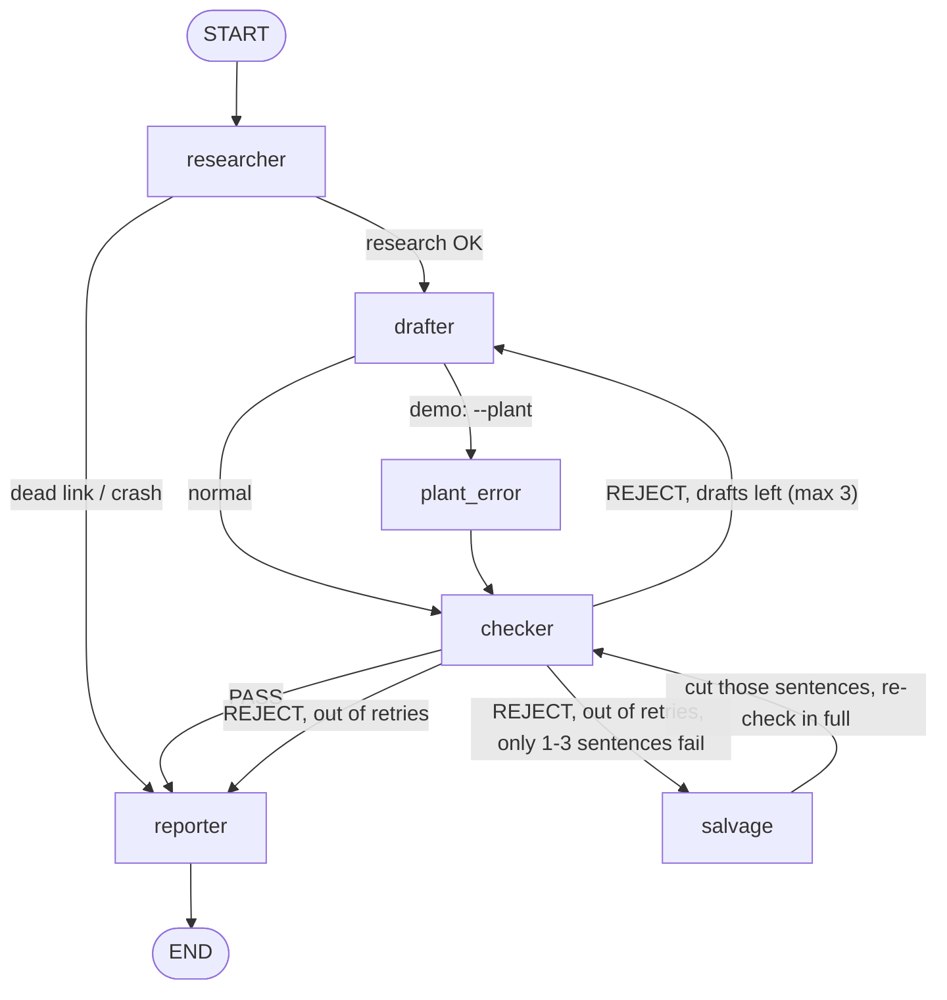
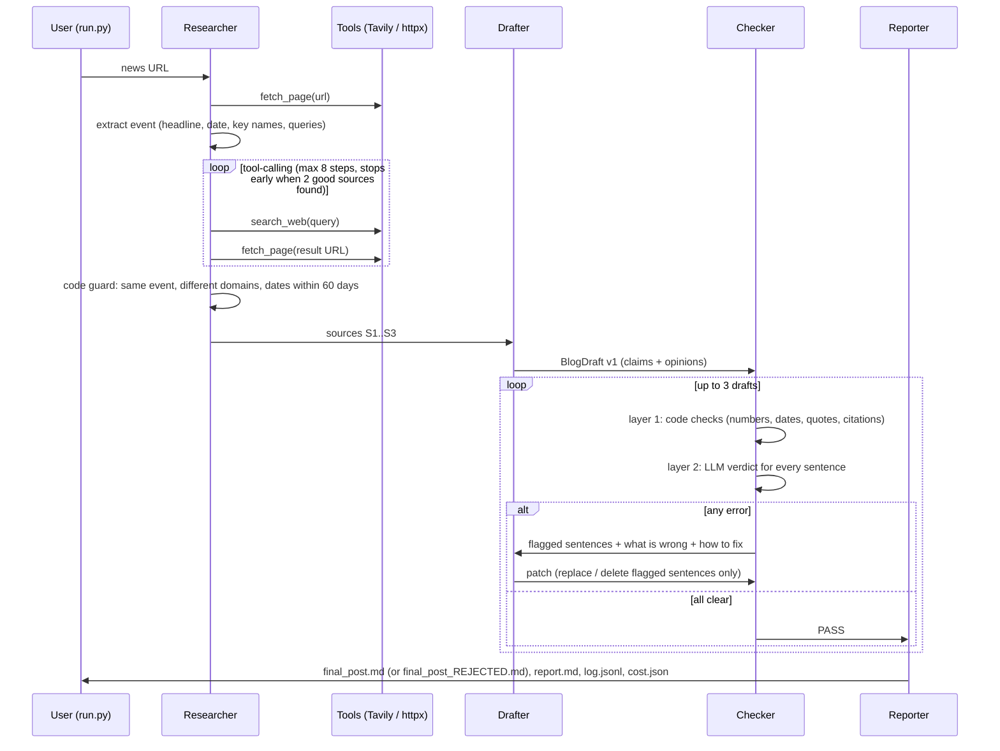

# News-to-Blog Writer: an agent that checks its own work

**AI FDE Fellowship · Sprint 1 · Task B** · Built by Yashraj Sharma with Python + LangGraph

Give it **one news link**. It reads the article, finds two other outlets covering the same event, writes a short blog post in a house tone, and then a **separate checker agent goes claim by claim** and rejects anything the sources don't back up. A post only comes out the other end if **every factual claim carries a source URL** and has been verified. A human editor approves it. Nothing is ever published automatically.

> **Results in one line:** on a 14-case test set, the four-role system passed **12/14** against **11/14** for a single-agent baseline. By hand review it shipped **1** wrong fact against **2**, and that one (a wrong year) is now caught by a new rule. It costs **2.5¢ per run**, and every claim carries a source URL.

---

## Contents
1. [The problem (discovery brief)](#1-the-problem)
2. [Results](#2-results)
3. [Architecture](#3-architecture)
4. [Workflow: what happens in one run](#4-workflow-what-happens-in-one-run)
5. [The checker in detail](#5-the-checker-in-detail)
6. [How we measured it](#6-how-we-measured-it)
7. [How we built it: the journey, failures and fixes](#7-how-we-built-it-the-journey-failures-and-fixes)
8. [Project structure](#8-project-structure)
9. [Setup and usage](#9-setup-and-usage)
10. [Configuration](#10-configuration)
11. [Limitations and next steps](#11-limitations-and-next-steps)
12. [Deliverables map](#12-deliverables-map)

---

## 1. The problem

Full brief: [`discovery_brief.md`](discovery_brief.md).

- **User:** a content writer at a tech company who has to turn breaking news into a sourced blog post fast.
- **Today:** about 2–3 hours per post, about 40 minutes of which is an editor checking every number against the sources. The real cost is the error that slips through (a wrong date, an invented statistic) and the public correction that follows.
- **What "good" means:** not "reads well" but **every claim has a source URL, and an independent judge finds no unsupported claims**, at under $0.05 a run.
- **What we automate:** research, the first draft and the first line-by-line fact-check. **What we don't:** the editor's approval.

---

## 2. Results

The final eval ran on OpenAI (`gpt-4o-mini` writer, `gpt-4.1-mini` checker, `gpt-4o` independent judge). The full table is in [`eval/results/scoreboard.md`](eval/results/scoreboard.md), and the raw per-case runs are in `eval/results/20261026-121837/`.

| | Day 1: single agent | Day 2: 4 roles + checker |
|---|---:|---:|
| Cases passed (of 14) | 11 | **12** |
| Bad posts shipped (judge) | 3 | 2 |
| Bad posts shipped (after hand review) | 2 | 1, now caught by a new rule |
| Withheld by the checker | 0 | 0 |
| Claims with a source URL | 100% | 100% |
| Claims supported (judge) | 97.1% | 98.0% |
| Avg drafts per run | 0.93 | 2.5 |
| Avg cost per run | $0.0168 | $0.0248 |

The eval (28 runs plus judging) cost **$1.09**.

**Hand review of every post the judge failed:**
- **Day 1 shipped real hallucinations.** c08 named "Snapchat and Coinbase" in an AWS outage story when no source mentions them. c04 gave an exact date the sources never give, and said the stock "closed at $210" when the source only says it traded above $210. A third flag (c09) was a judge false positive: the post simply doesn't mention the fact.
- **Day 2 shipped one real error.** c05 says "September 2, **2024**", but the ruling was in 2025. See [§7 #1](#7-how-we-built-it-the-journey-failures-and-fixes). The fix was **replayed on all 52 saved drafts without any API calls: it flags exactly this one, with zero false alarms.** A live re-run of c05 on the fixed code (`eval/results/20261026-123526/`, $0.03) now writes "September 2, **2025**". The judge's only remaining flag there is Reuters' "7.2%" versus AFP's "7.5 percent" for the stock move, a genuine source disagreement that `report.md` lists for the editor. The other flag (c08) follows its cited source word for word ("11:05 AM (UTC) on October 21"), while another source gives a different time, so the sources disagree rather than the post inventing anything.

**How the score moved as we fixed things** (same 14 cases, OpenAI):

| Round | Day 2 passed | Day 2 withheld | What changed before it |
|---|---:|---:|---|
| 1 | 6/14 | 7 | first version: whole-post rewrites, strict checker |
| 2 | 10/14 | 3 | patch-only retries, 4-fact minimum, tighter checker prompt |
| 3 | 10/14 | 4 | "sources disagree" becomes an editor note, fuller posts |
| **4 (final)** | **12/14** | **0** | code repairs citations, last-resort salvage of 1–3 failing sentences |

**Planted errors** ([`eval/results/planted_errors.md`](eval/results/planted_errors.md) on a fixture, [`planted_errors_real_run.md`](eval/results/planted_errors_real_run.md) on a real approved draft). Both gave the same result:

| Planted into a clean draft | Result | Caught by |
|---|---|---|
| Nothing (control) | ✅ passes, no false alarm | — |
| Invented statistic with a real-looking citation ("…revenue by 47%") | ✅ caught | code + LLM |
| Wrong date ("August 22" → "August 25") | ✅ caught | code + LLM |
| Uncited claim ("The CEO … will step down") | ✅ caught | code + LLM |
| Bonus: fact disguised as opinion ("Regulators have already opened an investigation") | ✅ caught | LLM only |

---

## 3. Architecture

### 3.1 The graph (LangGraph)



The checker → drafter edge is the **evaluator–optimizer** loop. Researcher → drafter → reporter is **prompt chaining**. Every node is wrapped in a crash guard: if an agent fails (an API outage, a model error), the run goes straight to the reporter and produces a clean failure report instead of a traceback.

### 3.2 The four roles

| Role | What it does | Model (OpenAI / Groq) | Code |
|---|---|---|---|
| **Researcher** | Fetches the article, extracts the event (headline, date, key names, search queries), then runs a **tool-calling loop** (`search_web`, `fetch_page`, `submit_sources`) to find 2 independent outlets covering the same event. A code guard checks the agent's choices. | `gpt-4o-mini` / `gpt-oss-20b` | [`agents/researcher.py`](news2blog/agents/researcher.py) |
| **Drafter** | Writes the post as **structured JSON**: every sentence is a `claim` (with source IDs and a verbatim evidence quote) or an `opinion` (no facts allowed). On rejection, it fixes **only the flagged sentences**. | `gpt-4o-mini` / `gpt-oss-120b` | [`agents/drafter.py`](news2blog/agents/drafter.py) |
| **Checker** | A **different model with its own prompt**. Two layers: deterministic code checks plus an LLM verdict for every sentence. Any error rejects the draft. | `gpt-4.1-mini` / `gpt-oss-20b` | [`agents/checker.py`](news2blog/agents/checker.py), [`verify.py`](news2blog/verify.py) |
| **Reporter** | Writes `report.md`: what each agent did, what was rejected and why, cost, and open doubts for the editor. **The LLM writes the narrative, and code fills in every number**, so the report can't make up costs or counts. | `gpt-4o-mini` / `gpt-oss-20b` | [`agents/reporter.py`](news2blog/agents/reporter.py) |

The drafter and checker are **always different models**: the system refuses to let the drafter check its own work, even as a fallback.

### 3.3 Supporting components

| Component | Purpose |
|---|---|
| [`tools.py`](news2blog/tools.py) | `fetch_page` (httpx + trafilatura, with a Tavily-extract fallback for bot-blocked sites) and `search_web` (Tavily) |
| [`llm.py`](news2blog/llm.py) | One wrapper for every model call: structured output, cost logging, retries, a per-model tokens-per-minute throttle, and error classification (rate limit, daily cap, billing, bad generation, missing model) that fails fast with a clear message |
| [`config.py`](news2blog/config.py) | Provider switch (OpenAI or Groq), a model preference list per role (**resolved against the models your key can actually use**), prices and limits |
| [`schemas.py`](news2blog/schemas.py) | Pydantic contracts between agents: `EventBrief`, `BlogDraft`/`Sentence`, `Revision`, `CheckerLLMOutput`, `ReporterOutput`, `JudgeOutput` |
| [`render.py`](news2blog/render.py) | Turns a `BlogDraft` into markdown with an inline `[[n]](url)` on every claim and the headline |
| [`runlog.py`](news2blog/runlog.py) | Per-run folder: `log.jsonl` (every agent action), each draft and verdict, and token/cost totals by agent |
| [`baseline.py`](news2blog/baseline.py) | The **Day 1** system: one agent with the same tools, model and writing rules, but no checker and no retries |
| [`agents/plant.py`](news2blog/agents/plant.py) | Error planting (stat / date / uncited / disguised) for the checker tests and the live demo |

### 3.4 Data contract: why structured sentences

```json
{ "title": "US government takes a 10% stake in Intel", "title_source_ids": ["S1","S3"],
  "sections": [{ "heading": "What happened", "sentences": [
     { "text": "The government will receive 433.3 million shares at $20.47 each.",
       "kind": "claim", "source_ids": ["S1","S3"],
       "evidence": "the government will receive 433.3 million shares of common stock for $20.47 apiece" },
     { "text": "For builders, the bigger question is how far governments will go.", "kind": "opinion" } ]}]}
```

Because every sentence declares what it is and where it comes from, "every claim has a source URL" stops being a hope and becomes something code can check.

---

## 4. Workflow: what happens in one run



**Step by step:**

1. **Fetch the article.** If it can't be read (a dead link, a paywall), the run fails cleanly and no post is written.
2. **Understand the event.** One structured call returns the headline, event date, key names and 2–3 search queries.
3. **Find corroborating sources.** The researcher agent searches and fetches on its own. Three safeguards apply:
   - It can **only open URLs that search returned**, because models invent plausible URLs.
   - The loop **stops early** as soon as 2 good sources are fetched.
   - A **code guard** rejects pages that fail to fetch, share a domain, don't mention the key names (whole-word match), or are dated more than 60 days from the original.
4. **Draft.** The drafter writes 350–500 words in the tone guide ([`tone_guide.md`](tone_guide.md)), using only facts from the sources and copying numbers and dates exactly.
5. **Check.** Two layers; see [§5](#5-the-checker-in-detail).
6. **Retry, surgically.** On rejection, the drafter gets each flagged sentence with the problem and a concrete fix hint ("Use the exact figure from the sources, or delete the sentence"). It returns `replace` or `delete` for **those sentences only**, and code merges the patch, so a retry can't break what already passed. A flagged sentence the model ignores is deleted. After every draft, **code repairs wrong citations**: if a number or date is in a different source than the one cited, *and that source mentions it in a sentence about the same thing*, that source is added. Text is never changed. There are at most 3 drafts.
7. **Salvage (last resort).** If the 3rd draft fails on only 1–3 individual sentences, code **cuts those sentences** and the full checker runs again, including the 4-fact minimum. Cutting an unverified line can't add an error, and `report.md` lists every cut. Otherwise the run fails, and the post is saved as `final_post_REJECTED.md`.
8. **Report.** The reporter writes `report.md` (status, verdicts per draft, what was rejected and why, a cost table and open doubts) and saves the post with a banner: *"Checker-approved DRAFT. A human editor must approve it."*

Every run writes `runs/<run_id>/`: `log.jsonl`, `sources.json`, `draft_vN.md/json`, `check_vN.json`, `final_post.md`, `report.md` and `cost.json`. See [`deliverables/sample_run/`](deliverables/sample_run/).

---

## 5. The checker in detail

| Layer | Checks | Why |
|---|---|---|
| **1. Deterministic** ([`verify.py`](news2blog/verify.py)) | Every claim has a citation and the cited IDs exist · every **number** in a claim appears in a cited source (unit-aware: `$1.5bn` = `1,500,000,000`; exact match, so 2021 ≠ 2022) · every **month-day date** appears in a cited source, and a full date's **year** matches what the source says for that date · the **evidence quote** is really in the source (word 5-gram overlap) · **opinion** sentences introduce no new figures or dates | Free, instant, and can't be talked into accepting a plausible "47%" |
| **2. LLM** ([`prompts.py`](news2blog/prompts.py) `CHECKER_SYSTEM`) | A verdict for **every** sentence: `supported` / `partially_supported` / `not_found` / `contradicted` / `not_a_claim`. Opinions get verdicts too, which catches facts disguised as opinion. | Catches what code can't: unsupported claims with no digits, wrong attributions, hidden facts |

**Rules that make it trustworthy:**
- **No verdict means failure.** Missing verdicts are re-asked, then sent to a backup checker model. If a claim still has no verdict, the run fails instead of passing.
- **A post needs at least 4 cited facts.** A post that deleted its way down to nothing can't pass.
- **The evidence quote is an audit aid.** If the LLM verified the claim against the full sources, a paraphrased quote is downgraded to a warning.
- **Source disagreement isn't the writer's error.** If a sentence matches its cited source but another source differs (8 vs 9 items), the verdict is `sources_disagree`. That's a warning listed for the editor in `report.md`, not a rejection.
- **Years are checked in context.** A full date ("September 2, 2024") must match the year a cited source gives for that date, or the year the source was published. A "2024" in an unrelated sentence doesn't count as support.

---

## 6. How we measured it

### Test set: [`eval/test_set.json`](eval/test_set.json)
13 real news links (Intel stake, the 2025 and 2026 Nobel prizes, the Anthropic settlement, Nvidia at $5T, the Google/Chrome ruling, the Louvre heist, the Cloudflare and AWS outages, Axiom-4, Meta/Scale AI, the OpenAI restructuring, Starship flight 10), each with **2–3 key facts checked by hand against the article**, plus 1 **dead link** that must fail cleanly.

### Day 1 vs Day 2: [`eval/run_eval.py`](eval/run_eval.py)
- **Day 1** = one agent, same tools, model and writing rules, no checker.
- **Day 2** = the four-role graph.
- Every shipped post is graded by an **independent judge**: a different model (`gpt-4o`) and a different prompt from the checker, so the system never grades itself. The judge labels each statement as `fact` or `interpretation`, and only facts need a citation.
- **A case passes** when the post ships, 100% of facts are cited, 0 are unsupported or contradicted, and no human-checked key fact is contradicted.
- Also tracked: **bad posts shipped** (the trust metric), posts withheld, cost, and drafts per run.
- Useful flags: `--workers N`, `--cases a,b`, `--resume <folder>` (continues after a rate-limit stop) and `--rejudge` (re-scores finished runs without re-running them).

### Planted errors: [`eval/planted_errors.py`](eval/planted_errors.py)
Takes a clean approved draft, plants each error, and checks that the checker rejects **the planted sentence specifically**, with a clean control that must pass. It runs on a fixture or on any real run (`--from-run`), and `--offline` tests the code layer with no API calls.

### Offline test suite: [`tests/`](tests/)
46 tests run in under a second with a **fake LLM and fake web**, covering: graph routing, the retry cap, the dead link, planted errors, the patch-only revision, "no verdict never passes", the thin-post rule, the invented-URL guard, the year-tolerance bug, model resolution, error classification and the eval scoring. **Each real failure we hit has a regression test.**

---

## 7. How we built it: the journey, failures and fixes

We followed the sprint plan: **checker prompt and test set first, then a working agent, then split it into roles, then measure.** Most of the useful learning came from failures, and each one now has a test.

| # | What went wrong (found in…) | Fix | Lesson |
|---|---|---|---|
| 1 | **A wrong year "was in the source".** The final eval's only real Day 2 error: "September 2, **2024**" (the ruling was in 2025). "2024" appeared in the source in an unrelated sentence, so the number check passed it, and the new citation repair even added a second source for the same reason. *(final eval)* | A year check for full dates · citation repair only accepts a source that mentions the figure in a sentence about the same thing · **replayed on all 52 saved drafts: catches exactly this one, no false alarms** | "The number appears in the source" isn't the same as "the source says this" |
| 2 | **The researcher invented a source.** It made up an NBC URL (`…rcna123456`), NBC redirected it to a 2023 article about pandas, and a loose relevance check (`"intel"` matched `"Intelligence"`) let it in. *(first live run)* | Fetch only URLs returned by search · whole-word key-name match · reject pages dated more than 60 days from the original | Guard an agent's **tools**, not just its output |
| 3 | **A PASS with nothing checked.** One checker model returned empty verdict lists, "no verdict" was only a warning, and a draft passed with 2 of 11 claims checked. *(live run)* | Silence counts as failure: re-ask, then a backup model, then refuse to pass | "No news" from a checker isn't good news |
| 4 | **Our own planted test found a bug.** A planted `2022 → 2021` passed the code layer because a 0.1% number tolerance treated the two years as equal. *(planted suite)* | Exact numeric matching | Planted errors test your **checker**, not just your writer |
| 5 | **Rewrites made drafts worse.** Full-post retries added new errors and once **deleted every fact**, so an empty post passed. *(eval round 1)* | Patch-only revisions merged by code · minimum of 4 cited facts | Constrain *what* a retry is allowed to change |
| 6 | **An over-strict opinion rule.** "The extra 5% warrant…" was rejected three times, although 5% was cited two sentences earlier. *(live run)* | Opinions may repeat figures already cited in the post | A rule that's too strict just makes the drafter loop |
| 7 | **An unfair judge.** It counted analysis sentences ("this validates…") as uncited facts. *(eval round 1)* | The judge labels `fact` vs `interpretation`, and only facts are scored | Your metric needs its own scrutiny |
| 8 | **Correct posts held back.** The checker rejected sentences when the *sources* disagreed (8 vs 9 Louvre items), and one bad sentence sank a whole post. *(eval rounds 2–3)* | A `sources_disagree` verdict that becomes an editor note · code repairs citations · last-resort salvage | Distinguish the writer's errors from the world's ambiguity |
| 9 | **Provider limits.** Groq's free tier allows about 8K tokens a minute and 200K a day **per model**, and an unavailable model (`llama-3.3-70b`) crashed a run. Qwen broke JSON output (thousands of `\r` characters). OpenAI's free tier allowed only 50 requests a day. | Pick models from the ones the key can actually use · a client-side throttle · JSON-schema mode with function-calling fallback · resumable eval · switched to OpenAI for the final eval | Infrastructure limits are product constraints; design for them |

---

## 8. Project structure

```
fde-first/
├── README.md                  ← you are here
├── discovery_brief.md         ← deliverable 1: user, metric, risks, scope
├── tone_guide.md              ← house style, derived from the customer's own blog
├── run.py                     ← CLI: run one URL (Day 2, Day 1, or with a planted error)
├── run_all.sh                 ← all deliverables in one go
├── requirements.txt · .env.example · .gitignore · graph.mmd
├── news2blog/                 ← the system
│   ├── graph.py               ← LangGraph: nodes, routing, retry loop, crash guards
│   ├── baseline.py            ← Day 1 single agent
│   ├── agents/                ← researcher · drafter · checker · reporter · plant
│   ├── verify.py              ← deterministic checker layer
│   ├── prompts.py · schemas.py · llm.py · tools.py · render.py · runlog.py · config.py
├── eval/
│   ├── test_set.json          ← deliverable 2: 14 cases with hand-checked key facts
│   ├── run_eval.py            ← Day 1 vs Day 2 with an independent judge
│   ├── planted_errors.py      ← deliverable 3: planted-error suite
│   ├── fixtures/intel/        ← clean draft + sources for reproducible tests
│   └── results/               ← scoreboard.md, planted_errors*.md, final eval run
├── deliverables/
│   ├── sample_run/            ← deliverables 4 and 5: report.md, log.jsonl, cost.json (OpenAI)
│   └── sample_run_groq/       ← the same demo on Groq, for comparison
└── tests/                     ← 46 offline tests (fake LLM, no API keys needed)
```

---

## 9. Setup and usage

```bash
git clone https://github.com/RedRumRex/fde-first-task.git && cd fde-first-task
python3 -m venv .venv && source .venv/bin/activate
pip install -r requirements.txt
cp .env.example .env            # add your keys (see below)
python -m pytest -q             # 46 offline tests, no keys needed
```

`.env` for OpenAI (used for the final results):
```
LLM_PROVIDER=openai
OPENAI_API_KEY=sk-...
TAVILY_API_KEY=tvly-...
```
Or for Groq: `GROQ_API_KEY=gsk_...` and `TAVILY_API_KEY=...` (Groq is the default provider).

**Commands**
```bash
python run.py --models                                   # which models your key can use, and the role assignment
python run.py "<news_url>"                               # Day 2: four agents + checker loop
python run.py "<news_url>" --plant date                  # demo: plant an error (stat|date|uncited|disguised)
python run.py "<news_url>" --day1                        # Day 1 single-agent baseline
python run.py --graph                                    # print the LangGraph as Mermaid

python -m eval.planted_errors                            # planted-error suite (fixture)
python -m eval.planted_errors --from-run deliverables/sample_run   # same, on a real approved draft
python -m eval.run_eval --workers 3                      # Day 1 vs Day 2 on all 14 cases (~$1, ~15 min on OpenAI)
python -m eval.run_eval --resume eval/results/<folder> --rejudge  # continue or re-score an eval
```

---

## 10. Configuration

Everything is set in `.env` (see [`.env.example`](.env.example)):

| Variable | Default | Meaning |
|---|---|---|
| `LLM_PROVIDER` | `groq` | `groq` or `openai` |
| `MODEL`, `RESEARCHER_MODEL`, `CHECKER_MODEL`, `REPORTER_MODEL`, `JUDGE_MODEL` | auto | Pin a model per role. Otherwise the first available from each role's preference list is used (the checker is never the drafter's model) |
| `MAX_RETRIES` | `2` | Rewrites after the first draft (so a maximum of 3 drafts) |
| `MIN_CLAIMS` | `4` | A post needs at least this many cited facts to pass |
| `MAX_SOURCE_CHARS` | 12000 (OpenAI) / 3000 (Groq) | Characters of each source given to the models |
| `TPM_LIMIT` | 0 (OpenAI) / 7500 (Groq) | Client-side tokens-per-minute pacing per model |
| `REASONING_EFFORT` | `low` | For gpt-oss reasoning models on Groq |

---

## 11. Limitations and next steps

- **We check against sources, not the truth.** "Supported" means a source says it. That's why we use 3 independent outlets and a human approves.
- **The final eval predates the last fix.** The year rule was proven by replay on saved drafts and a live re-run of the failing case, not by a fresh full eval, to save API budget.
- **Units and qualifiers** (for example "(UTC)") aren't yet checked by code, and c08 dropped one.
- **Syndicated copies** of one wire story can look like independent corroboration. **Next:** near-duplicate text detection.
- **Salvage shortens posts.** It only cuts sentences that fail, but a heavily salvaged post can get thin, though never below 4 cited facts.
- **Length is now enforced in code.** The eval drafts ran 144–331 words against a 350–500 target, because the model ignores word counts. The prompt now asks for sentence counts, and the checker rejects posts under 300 words (`MIN_WORDS`). The eval scores above were measured before this change.
- **The tone guide is our reading of the customer's blog** (four recent posts). Their editors should review it; the eval scores above were measured with the earlier placeholder guide.
- **The judge is an LLM too.** We review every failure by hand: 2 of the 5 judge flags in the final eval were wrong or debatable.

---

## 12. Deliverables map

| Sprint deliverable | Where |
|---|---|
| One-page discovery brief with success metric | [`discovery_brief.md`](discovery_brief.md) |
| Test set of 10–20 cases, with score | [`eval/test_set.json`](eval/test_set.json) → [`eval/results/scoreboard.md`](eval/results/scoreboard.md) |
| 3 planted-error tests the checker catches | [`eval/results/planted_errors.md`](eval/results/planted_errors.md), [`planted_errors_real_run.md`](eval/results/planted_errors_real_run.md), [`tests/test_planted_offline.py`](tests/test_planted_offline.py) |
| Run report from the reporter agent | [`deliverables/sample_run/report.md`](deliverables/sample_run/report.md) |
| Log of a full run, with cost | [`deliverables/sample_run/log.jsonl`](deliverables/sample_run/log.jsonl), [`cost.json`](deliverables/sample_run/cost.json) |
| Demo (brief, live run, planted error, Day 1 vs Day 2, a failure) | Presented live, using [`discovery_brief.md`](discovery_brief.md), a live `run.py --plant date` run, [`eval/results/scoreboard.md`](eval/results/scoreboard.md) and §7 of this README |

**Ground rules followed:** a human approves every output, and nothing is published or sent automatically · no personal data, only public news · API keys stay in `.env`, which is git-ignored.
